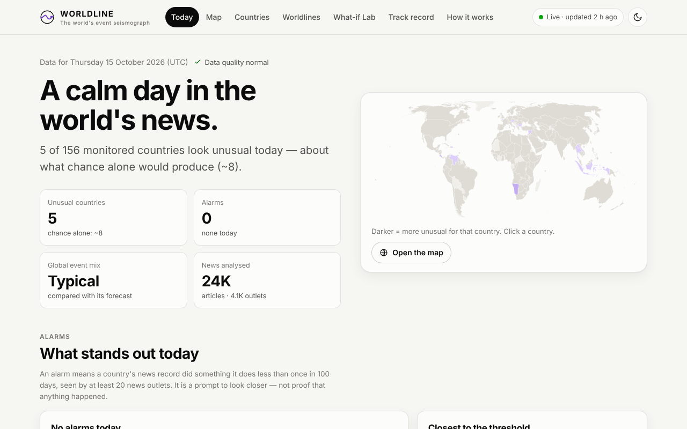
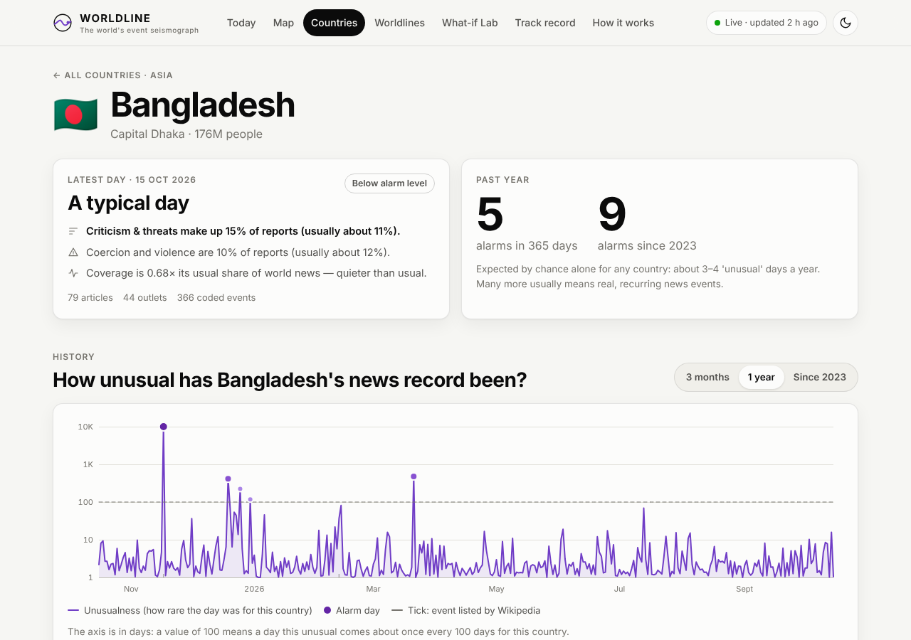
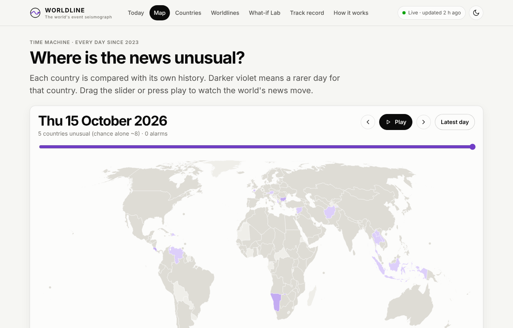
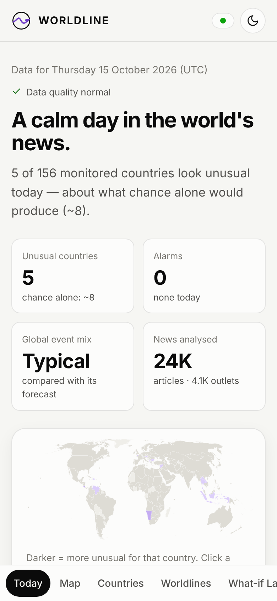
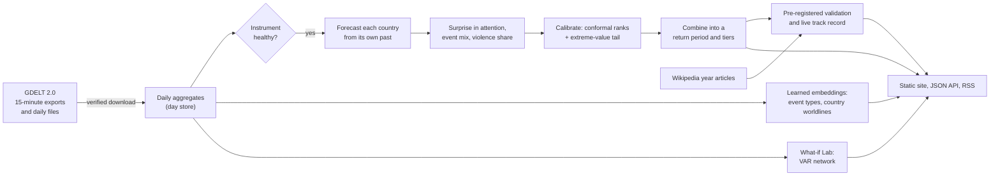

# WORLDLINE

**A live, validated observatory of the world's news.** Every hour WORLDLINE reads the global event record
that [GDELT](https://www.gdeltproject.org/) extracts from news worldwide and asks one question of each of
156 countries: *is today unusual for this country?* It answers in plain units ("a 1-in-400-days event for
this country"), explains why, links the reporting behind it, and keeps a public, pre-registered track record
of how often its alarms match real events.

**→ [Open the live site](https://chingkheinganba231005.github.io/worldlines-v0.2.0/)**

[](https://github.com/chingkheinganba231005/worldlines-v0.2.0/actions/workflows/live.yml)
[](https://github.com/chingkheinganba231005/worldlines-v0.2.0/actions/workflows/ci.yml)
[](LICENSE)

<picture>
  <source media="(prefers-color-scheme: dark)" srcset="docs/img/today-dark.png">
  
</picture>

## What you can do with it

| Page | Question it answers |
|---|---|
| **Today** | Is the world unusual today? Which countries stand out, and why? What is rising in the last 24 hours? |
| **Map** | Where? Drag through every day since 2023 and watch the world's news move. |
| **Countries / Country** | What is normal for this country, what changed, which articles and Wikipedia entries go with it? |
| **Worldlines** | How have countries' relations shifted? (learned embeddings of who interacts with whom, and how) |
| **What-if Lab** | Historically, when conflict reporting jumped in one country, where did it tend to spread? |
| **Track record** | Can I trust it? Pre-registered results, hits *and* misses, calibration, and the live record. |
| **How it works** | The method in eight plain steps, the data sources and the API. |

Everything is also available as a [static JSON API](docs/api.md) and an [RSS feed](https://chingkheinganba231005.github.io/worldlines-v0.2.0/feed.xml) of alarms.

<table>
  <tr>
    <td width="40%" valign="top">
      <picture>
        <source media="(prefers-color-scheme: dark)" srcset="docs/img/country-dark.png">
        
      </picture>
      <br><sub>A country page: today's reading and why, and how rare each day of the past year was (dots are alarms, ticks are events listed by Wikipedia).</sub>
    </td>
    <td width="40%" valign="top">
      <picture>
        <source media="(prefers-color-scheme: dark)" srcset="docs/img/map-dark.png">
        
      </picture>
      <br><sub>The map: every day since 2023, each country against its own history.</sub>
    </td>
    <td width="20%" valign="top">
      <picture>
        <source media="(prefers-color-scheme: dark)" srcset="docs/img/mobile-dark.png">
        
      </picture>
      <br><sub>Built for phones first.</sub>
    </td>
  </tr>
</table>

## Does it work? The honest answer

Before comparing anything with real events, we committed a [validation protocol](research/protocol.md):
four hypotheses, the metrics, and the labels — 610 internationally notable events from Wikipedia's year
articles, 2024-01-01 → 2026-10-15, across 156 countries. Then we ran it once and published
[every result](research/results.md), including the ones that failed.

| Pre-registered hypothesis | Outcome |
|---|---|
| **H1** WORLDLINE's alarms coincide with documented events more often than chance | **Supported.** AUC 0.719 (95% CI 0.696–0.739) vs 0.501 for random scores; alarms are 5.7–6.8× more likely than a random country-day to fall on a documented event (permutation p ≤ 0.001) |
| **H2** …and beat a naive "news volume spiked" detector | **Not supported.** The naive detector scored 0.742 |
| **H3** The *kind* of news (event mix, share of violence) carries signal on its own | **Partly.** Event mix 0.629; violence share at chance (0.511) |
| **H4** Learned embeddings improve detection | **Not supported.** No measurable gain (−0.006) |

What we changed because of it: the published detector (**v2.1**) was redesigned on 2023 data only — attention
counted in distinct articles, channel weights in proportion to their 2023 performance, alarms only when at
least 20 different publishers report. On the test period it reaches AUC 0.781 and 16% precision in the
*rare* tier (10.8× the base rate) — numbers we label **post hoc**, because the redesign came after seeing
the first run. The unbiased test is the **prospective record**: since 2026-10-16 every alarm is published
before any label for it can exist, and the site scores them automatically as Wikipedia catches up.

Some alarms from the test period and the events they matched: the assassination attempt on Donald Trump
(United States, 2024-07-14), the arrest of Rodrigo Duterte (Philippines, 2025-03-11), the Cambodia–Thailand
border clashes (2025-07-24), the death sentence for Sheikh Hasina (Bangladesh, 2025-11-17), the attempted
coup in Benin (2025-12-07). Many more alarms matched nothing in Wikipedia's lists — some are real events
those lists omit, some are artefacts. The *Track record* page shows both.

Are the "1 in N days" numbers honest? On 143,134 country-days with no listed event nearby, readings at
1-in-20 days occurred 5.1% of the time (nominal 5%) and at 1-in-100 days 1.2% (nominal 1%). At 1-in-1,000
days they occur about three times too often, which the site states.

## How it works



1. **Real data, verified.** Every day of the GDELT 2.0 event stream since 2023-01-01 (1,384 days at launch,
   growing hourly) from official archives, each transfer checked against the storage layer's MD5, gaps
   recorded as gaps. Only metadata — never article text.
2. **Each country against itself.** For 156 countries, forecasts from each country's own past (weekday-aware,
   trained only on earlier days) for three things: its share of world coverage, the mix of event types, and
   the share of coercion and violence.
3. **Calibrated surprise.** How rare is today's surprise compared with the last 365 days? Conformal ranks in
   the body and a generalized Pareto tail beyond it give a p-value, shown as a return period.
4. **Combination and alarms.** A weighted Cauchy combination (valid under dependence) gives one reading per
   country; alarms at 1-in-100, 1-in-365 and 1-in-1,000 days, only when ≥ 20 publishers report and the
   instrument is healthy.
5. **Learned embeddings.** Event types embedded from which events appear in the same article (PPMI + SVD);
   countries embedded from whom they interact with and how, aligned month to month (Procrustes). The
   learned geometry recovers CAMEO's own categories without being told them (54% vs 26% by chance) and
   places countries next to their regional neighbours (91% vs 23%).
6. **What-if Lab.** A regularised VAR(7) over 30 countries' conflict reporting with generalized impulse
   responses, bootstrap bands and Diebold–Yilmaz connectedness — presented as predictive association, not
   causation, with its (near-zero) out-of-sample skill shown next to it.
7. **Live.** A GitHub Actions workflow runs every hour, fetches the newest 15-minute exports, re-runs
   everything, adds a provisional "last 24 hours" view and publishes the site. No server, no cost.

Details: [methods](docs/methods.md) · [data and rights](docs/data_sources_and_rights.md) ·
[architecture decision](docs/adr/002-live-static-observatory.md) · [design](docs/design.md) ·
[model card](research/model_card.md) · [data card](research/data_card.md) · [operations](docs/operations.md).

## Run it yourself

```bash
git clone https://github.com/chingkheinganba231005/worldlines-v0.2.0 && cd worldlines-v0.2.0
python -m venv .venv && . .venv/bin/activate
pip install -r requirements.lock            # NumPy and SciPy (+ pytest, mypy for development)
pip install --no-deps -e .                  # makes `python -m worldline.cli` available

python -m worldline.cli build --out _site           # build the site from the committed data (~2 min)
python -m worldline.cli build --live --out _site    # …or fetch the latest GDELT data first
python -m http.server --directory _site 8000         # open http://localhost:8000

python -m pytest -q                                  # 85 tests in ~20 s
python -m worldline.cli evaluate                     # re-run the validation; reproduces research/results.json exactly
```

**Deploy your own live copy (free):** fork the repository, enable Actions, run the *Live* workflow once, then
*Settings → Pages → Deploy from a branch → `gh-pages` / (root)*. It updates itself every hour. See
[operations](docs/operations.md).

## Repository

```
backend/worldline/   the pipeline: gdelt (verified access) · aggregate · daystore · ingest · panel · monitor
                     · stats · embeddings · scenarios · labels · validate · experiments · live · publish · geo · cli
web/                 the site: vanilla ES modules, hand-built SVG charts, no build step
data/                committed day store 2023-01-01 → 2026-10-15, frozen Wikipedia labels, reference tables, model
research/            protocol (pre-registered), results, model and data cards
docs/                methods, API, data and rights, design, operations, architecture decisions
tests/               unit, statistical and end-to-end tests; browser smoke test
.github/workflows/   CI and the hourly live update
```

## Limits — please read

* WORLDLINE measures the **news record**, not the world. Coverage is uneven across countries and languages;
  a quiet news record is not a quiet country.
* An alarm is a **statistical signal in machine-coded news metadata**, not a verified event, and not a
  forecast. Check the linked reporting.
* It is a research and awareness tool, not for operational, security, humanitarian or financial decisions.

## About the GPU

An NVIDIA A100 was kindly offered for training. It is not needed, by design: the learned components are
linear-algebra models (PPMI + SVD, ridge regressions) that train in seconds on a CPU, which is what lets the
whole pipeline re-run every hour on a free GitHub runner and lets anyone reproduce every number. The natural
GPU-scale extension — transformer embeddings of article text — would require collecting the articles
themselves, which WORLDLINE deliberately does not do. If the project later adds text from openly licensed
sources, that is where the GPU would earn its place.

## Credits

Data: [The GDELT Project](https://www.gdeltproject.org/) · labels: Wikipedia contributors (CC BY-SA 4.0) ·
map: [Natural Earth](https://www.naturalearthdata.com/) via [world-atlas](https://github.com/topojson/world-atlas) ·
country codes: [GeoNames](https://www.geonames.org/) (CC BY 4.0). Code: [MIT](LICENSE).
Version history: [CHANGELOG](CHANGELOG.md).
